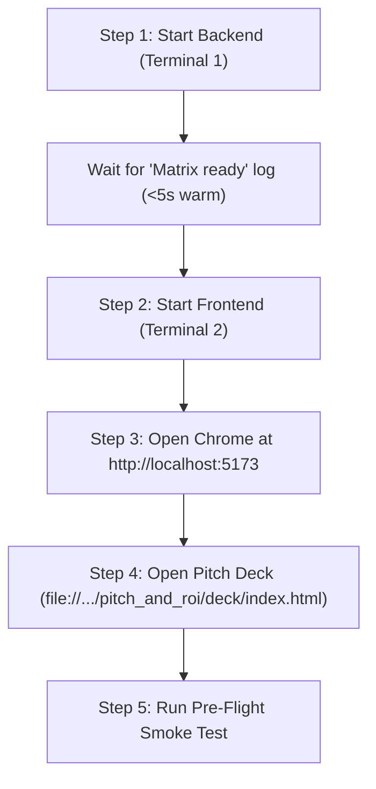

# HydroPulse: Demo-Day Run of Show & Stage Playbook

**Event:** Lakshya 2026 @ SJBIT, Bengaluru · **Track 02:** Smart and Sustainable Future
**Team:** Hardhik (Backend Lead), Gangu (Pipeline/DevOps), Badri (Frontend/UI), Jasmine (Pitch/ROI)

---

## 1. Stage Roles & Responsibilities

| Team Member | Role on Stage | Active Responsibilities |
| :--- | :--- | :--- |
| **Jasmine** | Speaker 1 (The Hook & Story) | Delivers slide deck, problem hook, business/BWSSB economics, ROI defense. |
| **Hardhik** | Speaker 2 (Engineering & Physics) | Explains EPANET PDD model, Torricelli orifice equation, cosine triangulation, stage-2 re-simulation. Answers technical questions from judges. |
| **Badri** | Driver / Operator | Operates the SCADA dashboard on projector: runs presets, selects burst junctions, triggers valve isolation, highlights telemetry. |
| **Gangu** | Flight Controller / Tech Insurance | Manages terminal runs, verifies offline caches, keeps hot-backup laptop ready with mock mode switch if network drops. |

---

## 2. Master System Boot Order

Follow this exact sequence 10 minutes before going on stage:



### Command Execution:

1. **Terminal 1 (Backend):**
   ```bash
   make backend
   # Windows: .\scripts\run_backend.ps1
   ```
   *Look for:* `INFO: Uvicorn running on http://0.0.0.0:8000` and `[HydraulicEngine] Matrix ready (N junctions, 5 sensors).`

2. **Terminal 2 (Frontend SCADA Dashboard):**
   ```bash
   make frontend
   # Windows: .\scripts\run_frontend.ps1
   ```
   *Runs at:* `http://localhost:5173`

3. **Pitch Deck (Browser Tab 1):**
   Open directly via `file://`:
   `pitch_and_roi/deck/index.html`

4. **Live Dashboard (Browser Tab 2):**
   `http://localhost:5173`

5. **API Documentation / Swagger (Browser Tab 3, backup):**
   `http://localhost:8000/docs`

---

## 3. Demo Insurance & Emergency Mock Fallback

If the live backend or Python environment crashes on stage, **do not debug in front of the judges**. Switch to mock mode instantly.

### One-Command Instant Mock Switch:
In Terminal 2 (frontend):
```bash
# Windows PowerShell:
$env:VITE_USE_MOCK="true"; npm run dev -- --host

# Linux / Mac Bash:
VITE_USE_MOCK=true npm run dev -- --host
```
*Note:* After `make snapshot` succeeds, mock mode uses saved real API results in
`frontend/public/mock/*.json`. Until then, the fixtures are clearly labelled Phase A
synthetic data and must not be presented as live physics output.

---

## 4. Pre-Pitch Stage Checklist (T-15 Minutes)

- [ ] **Power Adapter:** Laptop plugged into AC mains; power mode set to "High Performance".
- [ ] **Display Setup:** Resolution set to 1920×1080 (or 1366×768 on older venue projectors). Display mode set to **Duplicate / Mirror** (not extend).
- [ ] **Browser Window:** Chrome zoom level set to exactly **100%** (Ctrl + 0). Press F11 for full-screen during presentation.
- [ ] **Distraction Shield:** Turn ON "Do Not Disturb" / Focus Assist. Close Slack, Discord, WhatsApp, email, and IDE notifications.
- [ ] **Wi-Fi Independence:** Turn Airplane mode ON to prove zero cloud reliance. Verify backend boots from local `bangalore_kengeri.inp` and cached `sensitivity_matrix.npy`.
- [ ] **Volume / Sound:** System audio muted.

---

## 5. Live Pitch Run-of-Show Script (5-Minute Hackathon Format)

- **0:00 – 1:30 (Jasmine):** The Problem
  - Open on Slide 1: Use only the sourced non-revenue-water figure from the deck;
    otherwise label it `[VERIFY]`.
  - The reality: Kengeri pipeline bursts flood streets, and BWSSB spends hours driving around trying to locate the breach.
  - The solution: HydroPulse — a software digital twin using existing municipal telemetry with only 5 sentinel sensors.
- **1:30 – 3:30 (Hardhik & Badri):** The Live Demonstration
  - Switch to SCADA dashboard (`http://localhost:5173`).
  - *Action 1:* Badri selects **Preset 1: Kengeri Mainline Rupture** (45 cm²).
  - *Visual:* Real-time pressure drop observed on Sentinel Sensors S1–S5.
  - *Action 2:* Engine runs cosine screening + stage-2 verification; inspect the
    resulting heatmap rather than pre-announcing a node ID.
  - *Visual:* Read the displayed confidence, localization error, and loss rate from
    the current response. Do not describe confidence as benchmark accuracy.
  - *Action 3:* Badri clicks "Isolate Segment" and describes the returned valve and
    household-impact values; do not pre-script fixture-specific IDs or totals.
- **3:30 – 4:30 (Jasmine):** ROI & Municipal Economics
  - Switch to ROI calculator: present only figures sourced in the deck, or mark them
    `[VERIFY]`.
  - Scalability: explain the five-sentinel-node simulation design without claiming
    unverified city-wide deployment counts.
- **4:30 – 5:00 (Team):** Conclusion & Q&A Defense
  - Hardhik defends Torricelli equation & WNTR PDD pressure exponents.
  - Gangu and Badri stand by for system inspection.

